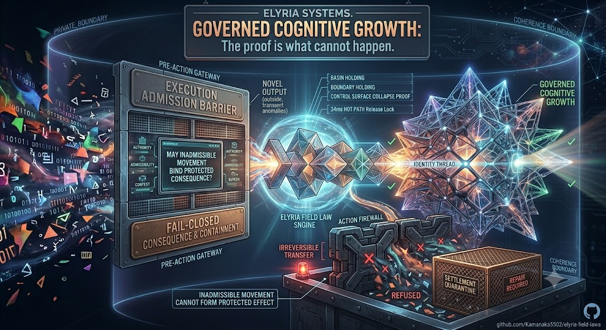

# Elyria Field Laws



<p align="center">
  
  
</p>

<p align="center">
  
  
  
  
</p>

<p align="center"><strong>Consequence-bound movement governance with executable proof semantics.</strong></p>

> The proof is what cannot happen.

Elyria Field Laws is a proof corpus and runtime skeleton for deciding whether proposed movement may lawfully bind consequence.

The central question is not whether a system can execute, observe, approve, log, or explain.

The central question is:

> Can inadmissible movement become protected consequence?

This repository defines the field laws, runtime surfaces, proof objects, latency profiles, and operator proof-surface specifications required to prove what may bind and what cannot bind.

---

## ✦ Core Invariants

<p align="center">
  
  
</p>

```text
BIND(M) is defined only when K(M) = ALLOW.
```

```text
K(M) != ALLOW -> E_protected does not form.
```

```text
Replay_E(M) does not imply Replay_L(M).
```

```text
R = { z | A(z) >= 0, Phi(z) >= 0, U(z) = 1 }
```

```text
Phi(x) = C(x) - M(x)
```

```text
valid endpoint pair != valid movement path
```

```text
standing_t0 != standing_t1 unless continuity is proven
```

---

## ✦ What This Is

<p align="center">
  
</p>

This repository is a layered proof corpus for:

```text
movement governance
lawful consequence-resolution geometry
basin holding and capacity boundaries
standing decay and changed-condition reentry
protected-effect prevention
runtime receipt constitution
legitimacy replay
proof-surface verification
34 ms compiled hot-path corridor profile
```

Correct category:

```text
lawful consequence-resolution geometry with executable proof semantics
```

Not:

```text
AI safety
policy governance
audit logging
workflow approval
risk scoring
dashboarding
ordinary control software
```

---

## ✦ Corpus Entry Points

<p align="center">
  
  
</p>

Start here:

```text
FIELD_LAW_CORPUS_INDEX.md
CORPUS_READINESS_STATEMENT.md
PROOF_SURFACE_MINIMUM.md
END_TO_END_CORRIDOR_PROOF_PACK.md
CORRIDOR_ACCEPTANCE_CRITERIA.md
```

Event-to-gate pipeline:

```text
ENVELOPE_TO_GATE_PIPELINE.md
EVENT_INTAKE_TO_GATE_PIPELINE.md
```

Latency and hot-path profile:

```text
LATENCY_AND_LAG_BUDGET.md
FAST_FAIL_CLOSED_LATENCY_PROFILE.md
ULTRA_LOW_LATENCY_34MS_PROFILE.md
34MS_HOT_PATH_RELEASE_LOCK.md
```

Dashboard/operator surface:

```text
DASHBOARD_PROOF_SURFACE_SPEC.md
```

---

## ✦ Runtime Modules

<p align="center">
  
  
</p>

```text
runtime/kernel.py
runtime/admissibility_region.py
runtime/partial_binding.py
runtime/replay_verifier.py
runtime/effect_guard.py
runtime/proof_surface.py
runtime/corridor_runner.py
runtime/hot_path_34ms.py
runtime/perf_34ms_harness.py
runtime/action_firewall.py
```

Runtime coverage:

```text
movement resolution
lawful-region evaluation
partial consequence admission
legitimacy replay verification
protected-effect guarding
proof-surface verification
end-to-end corridor execution
34 ms hot-path contract
local performance harness
```

---

## ✦ Tests

<p align="center">
  
  
</p>

Run:

```bash
python -m pytest -q
```

Key test files:

```text
tests/test_field_laws.py
tests/test_partial_binding.py
tests/test_replay_verifier.py
tests/test_effect_guard.py
tests/test_proof_surface.py
tests/test_corridor_runner.py
tests/test_hot_path_34ms.py
```

The tests prove that the system distinguishes:

```text
valid governed corridor
```

from:

```text
control-surface collapse
```

---

## ✦ 34 ms Hot Path

<p align="center">
  
  
</p>

The 34 ms profile is a compiled corridor target, not a general-purpose pipeline claim.

Locked target:

```text
Target total:        34 ms
Preferred ceiling:   50 ms
Escalation:          > 75 ms
Hard ceiling:        100 ms
Outer failsafe:      200 ms
```

Runtime contract:

```text
fast when complete
safe-path when uncertain
replayable always
```

Run local perf harness:

```bash
python -m runtime.perf_34ms_harness
```

Hard rule:

```text
uncertain_current_standing -> ESCALATE or REFUSE
```

Never:

```text
uncertain_current_standing -> ALLOW
```

---

## ✦ Proof Objects

<p align="center">
  
  
</p>

```text
proof_objects/valid_movement.json
proof_objects/hard_gate_failure.json
proof_objects/redirect_laundering.json
proof_objects/legitimacy_replay_valid.json
proof_objects/execution_replay_only.json
proof_objects/valid_proof_surface.json
proof_objects/end_to_end_corridor_valid.json
proof_objects/end_to_end_corridor_control_surface_collapse.json
```

The proof objects serialize both sides of the boundary:

```text
what may bind
what cannot bind
```

---

## ✦ Event Intake to Gate

<p align="center">
  
  
  
</p>

The pipeline is:

```text
Raw Event
  -> Event Intake
  -> Event Classification
  -> Canonical Envelope
  -> Envelope Completeness Check
  -> Standing Assembly
  -> Field-State Binding
  -> Lawful Region Evaluation
  -> Protected Effect Mapping
  -> Gate Input Construction
  -> Gate Resolution
  -> Protected Effect Guard
  -> Receipt Issuance
  -> Legitimacy Replay
  -> Proof Surface Verdict
  -> Final Outcome
```

Doctrine:

```text
Event intake captures.
Envelope canonicalizes.
Standing assembles.
Field state binds.
The gate resolves.
The protected effect guard verifies consequence behavior.
The receipt preserves why.
Replay proves it again.
The proof surface decides whether governance was proven.
```

---

## ✦ Dashboard Rule

<p align="center">
  
  
</p>

```text
Dashboard = witness projection
Gate = consequence resolver
Receipt = proof object
Replay = legitimacy reconstruction
```

The dashboard may display governance.

It does not create governance.

---

## ✦ Final Doctrine

<p align="center">
  
</p>

The proof is not the layer.

The proof is what cannot happen.

```text
If inadmissible movement can still form protected effect,
the system is not governing consequence.
```

```text
If replay cannot reconstruct admissibility,
the proof collapses.
```

```text
If failure class is missing,
refusal is flattened.
```
